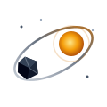
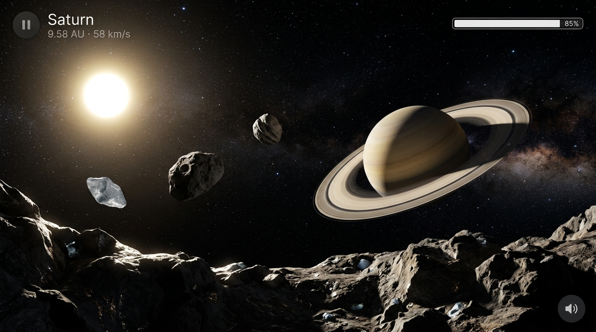
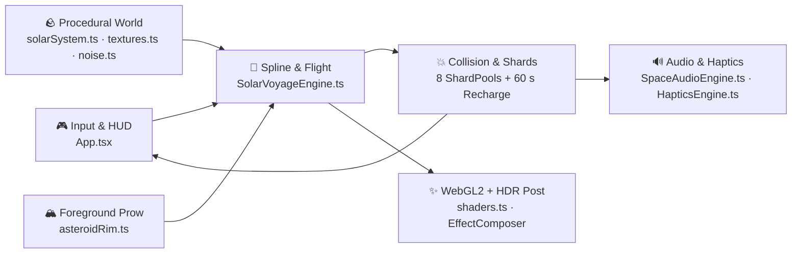

<div align="center">

<picture>
  <source media="(prefers-color-scheme: dark)" srcset=".github/assets/logo-dark.svg" />
  <source media="(prefers-color-scheme: light)" srcset=".github/assets/logo-light.svg" />
  
</picture>

<h1>Perihelion</h1>

**A procedural first-person 3D asteroid voyage through the Solar System in the browser.**

Ride a tumbling asteroid along a closed orbital loop from Neptune at 30.07 AU down to a 0.09 AU solar perihelion,<br />
with zero external textures, models, or audio files; every planet, rock class, shader, and sound is generated at runtime.

[](https://threejs.org/)
[](https://react.dev/)
[](https://www.typescriptlang.org/)
[](https://vite.dev/)
[](https://tailwindcss.com/)
[](https://lucide.dev/)
[-475569?style=flat-square)](#license)

[**Features**](#features) · [**How it works**](#how-it-works) · [**Getting started**](#getting-started) · [**Project structure**](#project-structure) · [**License**](#license)

<br />



</div>

---

<a id="features"></a>

## ✨ Features

| Feature | Description |
| :--- | :--- |
| 🪐 **Full Solar System loop** | Flies a closed 14-point `CatmullRomCurve3` trajectory (~155 s full orbit) across 10 sectors from Neptune (`30.07 AU`) past all 8 planets, Earth's Moon, and the Main Asteroid Belt to Solar Perihelion (`0.09 AU`). |
| 🪨 **8 procedural asteroid classes** | Renders `596` instanced bodies on desktop (`414` on mobile) spanning C-type diamond-top rocks, bilobed contact binaries, grooved S-type silicates, metallic M-type iron chunks, cratered V-type basalt, quartz-veined slate slabs, refractive ice monoliths, and pitted comets. |
| 💥 **Impact chipping & fracture pools** | Detects collisions against the 9-part foreground asteroid prow, deflects and asymmetrically chips the struck asteroid, and spawns `14` desktop (`10` mobile) material-matched shards per hit plus `108` (`72` mobile) pooled impact dust flecks. |
| 🔋 **Hull integrity & 360° rest look** | Depletes hull integrity by `0.18–0.28` per impact; reaching `0` halts travel for `60 s` with a right-to-left pulsing green recharge bar while unlocking 360° yaw and `±84.6°` pitch free-look. |
| 🎨 **100% procedural PBR & HDR post** | Generates `1024×512` planet textures, a `2048×16` Saturn ring strip, `512×512` seamless toroidal asteroid maps with 3×3 Sobel normals, and a `HalfFloatType` pipeline with MSAA (`4×`/`2×`), HDR bloom (`1.08` threshold), 5-tap CAS sharpening, peripheral motion blur, and 14-sample solar god-rays. |
| 🔊 **Procedural Web Audio & haptics** | Synthesizes 10 sector-keyed modal chords, a 3.2 s procedural convolver reverb, pink-noise solar wind, stereo Doppler flybys, layered rock/ice fracture impacts, and cooldown-gated `navigator.vibrate` haptics with zero audio files. |
| ⌨️ **Desktop & mobile controls** | Supports silent 4-way `WASD`/Arrow flight steering and `Esc` pause on PC, plus side-edge touch steering (`<44%` / `>56%`), fullscreen or CSS-rotated 90° Landscape Mode, and safe-area HUD scaling on phones and tablets. |

---

<a id="how-it-works"></a>

## 🧭 How it works



1. **Procedural world bootstrap:** On mount, `SolarVoyageEngine` builds all geometry and textures in memory: `7,200` desktop (`4,800` mobile) blackbody-colored stars with 32% concentrated along an inclined 38° galactic band, all 8 planets plus Earth's Moon with `1024×512` canvas PBR maps, a 9-part foreground asteroid rim (`asteroidRim.ts`), and 8 instanced asteroid classes (`solarSystem.ts`).
2. **Orbital spline & steering:** Each frame advances `progress` along a closed 14-point `CatmullRomCurve3` starting at Neptune (`progress = 0.032`). Lateral (`±16.5`) and vertical (`±8.4`) flight offsets respond to PC `WASD`/Arrow keys or mobile edge-touch presses, banking the camera and foreground prow smoothly into turns.
3. **Collision, chipping & 60 s stasis:** Incoming instanced asteroids are tested against the foreground hull radius (`rock.radius + 2.45`). Impacts chip and deflect the struck body, emit pooled shards matching its material class (rock slab, metallic splinter, or ice crystal), trigger layered audio/haptic cues, and reduce hull integrity. At `0`, forward travel pauses for `60 s` while free-look camera rotation unlocks; once refilled, the view glides back along the shortest angular arc.
4. **HDR compositing & adaptive scaling:** Scenes render through a `HalfFloatType` `EffectComposer` with `4×` desktop (`2×` mobile) MSAA, `UnrealBloomPass` (`threshold: 1.08`), and a single-pass `CinematicPostShader` combining 5-tap AMD FidelityFX CAS sharpening, peripheral-only motion blur (`radialDist > 0.44`), 14-sample radial solar rays, perihelion heat shimmer, and film grain.

> [!NOTE]
> `SolarVoyageEngine` inspects the active WebGL renderer string at startup. On software rasterizers (`SwiftShader` / `llvmpipe`), it automatically skips shadows and post-processing and paces frames with `fenceSync` to keep the browser responsive. On hardware GPUs, DPR is capped to a pixel budget (`8.3M` px desktop / `2.2M` px mobile) and steps down if average frame time exceeds `36 ms` for `3 s`.

---

<a id="getting-started"></a>

## 🚀 Getting started

**Requirements:** Node.js 20+ (verified on `v22.23.2`), npm (or Bun), and a WebGL2-capable browser. No API keys or `.env` configuration are required to run the app.

1. **Clone the repository**

   ```bash
   git clone <repository-url>
   cd perihelion
   ```

2. **Install dependencies**

   ```bash
   npm install
   ```

3. **Start the development server on port `3000`**

   ```bash
   npm run dev
   ```

   Open `http://localhost:3000` in your browser and press **Play** to unlock Web Audio and begin the voyage.

> [!TIP]
> **Controls:** On desktop, use `W`/`A`/`S`/`D` or the Arrow keys to steer in flight (and to orbit the camera 360° during the 60 s recharge pause), and press `Esc` to open the pause menu (`Resume`, `Restart`, or `Quit`). On mobile or touch screens, press and hold the left (`<44%`) or right (`>56%`) edge to steer, drag anywhere to look 360° while recharging, and tap the bottom-right orientation icon to toggle Landscape Mode.

<details>
<summary><strong>Type-checking, production build, and preview commands</strong></summary>

This repository does not currently include an automated test suite; verification runs through TypeScript type-checking and the Vite production bundle.

```bash
# Type-check without emitting files (tsc --noEmit)
npm run lint

# Build the production bundle into dist/
npm run build

# Serve the built dist/ bundle locally
npm run preview

# Remove build output
npm run clean
```

</details>

---

<a id="project-structure"></a>

## 📁 Project structure

```text
.
├── .github/
│   └── assets/
│       ├── cover.jpg                 # 16:9 README cover visual
│       ├── logo-dark.svg             # Dark-theme orbital mark
│       └── logo-light.svg            # Light-theme orbital mark
├── src/
│   ├── audio/
│   │   ├── HapticsEngine.ts          # Cooldown-gated navigator.vibrate patterns
│   │   └── SpaceAudioEngine.ts       # Procedural Web Audio synth, 10 modal chords, Doppler & impacts
│   ├── scene/
│   │   ├── SolarVoyageEngine.ts      # Main loop, camera, collisions, shard pools, HUD & HDR composer
│   │   ├── asteroidRim.ts            # 9-part foreground asteroid prow, ore/ice veins & 90 vapor particles
│   │   ├── noise.ts                  # Seeded PRNG, 3D simplex noise, fBM, ridged & seamless toroidal noise
│   │   ├── shaders.ts                # Starfield, solar corona, Fresnel atmospheres & CinematicPostShader
│   │   ├── solarSystem.ts            # 14-point orbital spline, 8 planets + Moon & 8 asteroid classes
│   │   └── textures.ts               # Procedural 1024×512 planet, 2048×16 ring & 512×512 asteroid PBR maps
│   ├── App.tsx                       # React shell, welcome/pause modals, HUD, WASD & touch/landscape routing
│   ├── index.css                     # Tailwind CSS v4 entry, safe-area variables & ripple/recharge keyframes
│   └── main.tsx                      # React 19 root mount
├── index.html                        # HTML entry point & OpenGraph metadata
├── metadata.json                     # App manifest metadata
├── package.json                      # Dependencies & npm scripts (dev, build, preview, lint, clean)
├── tsconfig.json                     # TypeScript compiler configuration
└── vite.config.ts                    # Vite 8 + React + Tailwind v4 configuration
```

---

<a id="license"></a>

## 📄 License

This repository is marked `"private": true` in `package.json` and does not currently include a `LICENSE` file. All rights are reserved by the author unless a license is added to the repository.
